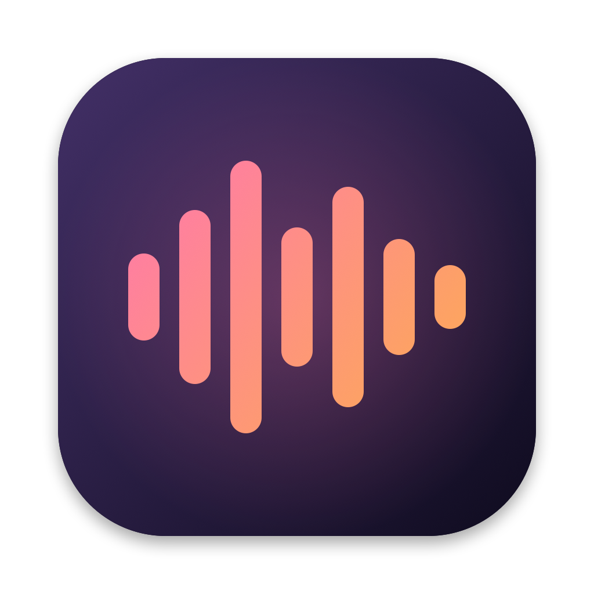
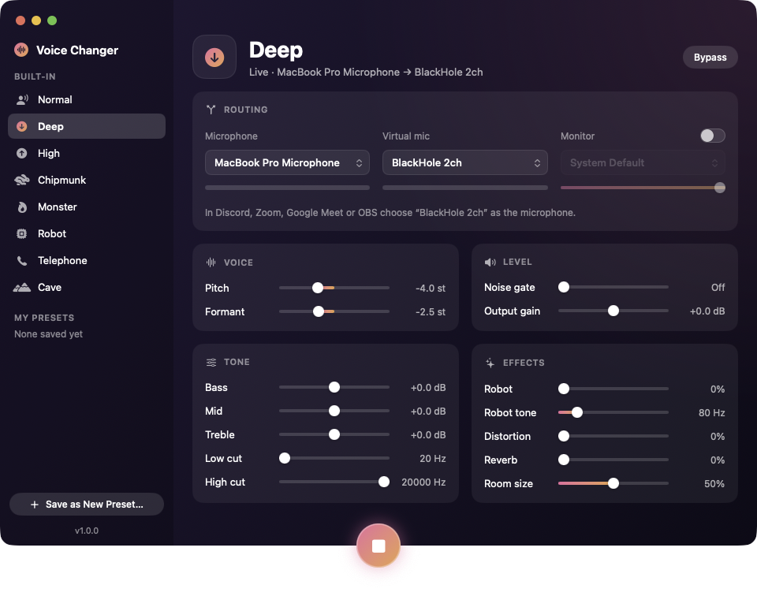

# Voice Changer

[](https://github.com/abaicus/voice-changer/actions/workflows/ci.yml)
[](https://github.com/abaicus/voice-changer/releases/latest)
[](LICENSE)


A real-time voice changer for macOS. It takes any microphone, changes your voice, and sends the result to a virtual microphone that Discord, Zoom, OBS and other apps can use.



Website: [abaic.us/voice-changer](https://abaic.us/voice-changer)

## Features

- Independent pitch and formant control, plus robot, distortion, reverb, EQ and a noise gate
- Built-in presets and your own saved presets
- Monitoring: hear the changed voice in your headphones, with input and output level meters
- Works with any input device (any sample rate, mono or multi-channel) and follows device changes
- Menu bar item for quick on/off, monitor, bypass and preset switching

## Requirements

- macOS 14 or later
- **[BlackHole](https://github.com/ExistentialAudio/BlackHole) is required.** It provides the virtual microphone that other apps record from. Voice Changer does not work without it.

```sh
brew install blackhole-2ch
```

## Install

1. Download `VoiceChanger.zip` from the [latest release](https://github.com/abaicus/voice-changer/releases/latest).
2. Unzip it and move `VoiceChanger.app` to `/Applications`.
3. The app is not signed or notarized, so macOS blocks the first launch. Try to open it once and click **Done**, then go to **System Settings › Privacy & Security**, scroll down and click **Open Anyway**. Or remove the quarantine flag:

```sh
xattr -dr com.apple.quarantine /Applications/VoiceChanger.app
```

## Build from source

Requires Xcode 16 or later (Swift 6 toolchain).

```sh
./Scripts/build-app.sh
open build/VoiceChanger.app
```

Set `VERSION=1.2.3` to stamp a version into the app; without it the latest git tag is used if there is one. `./Scripts/package-app.sh` then zips the app to `build/VoiceChanger.zip`.

The app is ad-hoc signed, so macOS asks for microphone access again after each rebuild. To keep the permission, sign with your own identity:

```sh
CODESIGN_IDENTITY="Apple Development: you@example.com (TEAMID)" ./Scripts/build-app.sh
```

## Use

1. Turn **Voice Changer** on and allow microphone access.
2. Leave **Virtual mic** on BlackHole 2ch.
3. In the app you are talking in, choose **BlackHole 2ch** as the microphone: Discord (Voice & Video > Input Device), Zoom (Settings > Audio > Microphone), Google Meet (Settings > Audio > Microphone), OBS (add an Audio Input Capture source and pick BlackHole 2ch).
4. Pick a preset, or move the sliders and choose **Save as New Preset…**.

Tick **Monitor** to hear yourself. Use headphones; speakers feed back into the mic. Pitch or formant shifting adds about 50 ms of delay, which you will notice when monitoring.

If you use a Bluetooth headset, do not pick its built-in microphone as the input. macOS switches the headset to a low-quality call mode when its mic is in use, which makes all audio sound worse. Use another microphone, such as the Mac's built-in one, instead.

Custom presets are stored in `~/Library/Application Support/VoiceChanger/presets.json`.

## How it works

```
mic ─▶ CoreAudio IOProc ─▶ DSP (C++) ─┬─▶ ring ─▶ output engine ─▶ BlackHole
                                      └─▶ ring ─▶ output engine ─▶ headphones
```

- `Sources/VoiceDSP` is the realtime core in C++: the effect chain, the mono mix-down and the ring buffers. The ring readers resample by a fraction of a percent to absorb clock drift between devices.
- `Sources/VoiceChangerKit` holds device discovery, the audio pipeline, presets and the app model.
- `Sources/VoiceChanger` is the SwiftUI app and menu bar item.

The microphone is captured directly with a CoreAudio IOProc (`Sources/VoiceChangerKit/DeviceInput.swift`), and each output runs in its own `AVAudioEngine`. The DSP runs at the microphone's sample rate and the output engines convert to whatever each output device wants.

## Tests

```sh
swift test                           # DSP and preset tests, no hardware needed
VC_LIVE=1 swift test --filter live   # opens the real default mic and BlackHole
```

## Contributing

Issues and pull requests are welcome. Releases are automated with semantic-release, so commit messages must use conventional prefixes: `feat:` (minor release), `fix:` (patch release), or `chore:`, `ci:`, `test:`, `docs:` (no release). Mark breaking changes with `!` or a `BREAKING CHANGE:` footer.

## Credits

Pitch and formant shifting use [Signalsmith Stretch](https://github.com/Signalsmith-Audio/signalsmith-stretch) (MIT), vendored under `Sources/VoiceDSP/vendor`.

## License

GPL-3.0, see [LICENSE](LICENSE). Forks and derivative works must stay open source under the same licence.
